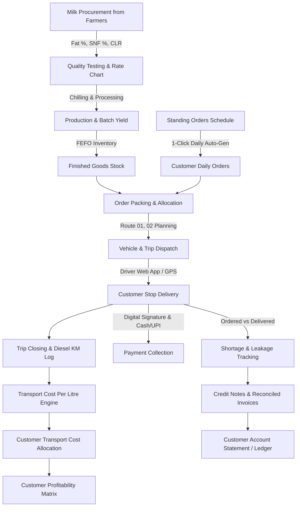

# AmritStream Dairy ERP — Complete Enterprise Architecture

## 1. System Overview & Tech Stack
**AmritStream Dairy ERP** is a full-featured, distribution-first enterprise resource planning system tailored specifically for dairy processing and daily cold-chain distribution.

- **Database Engine**: PostgreSQL 14+ (production) with dual-mode zero-config SQLite automatic development fallback.
- **Backend**: Python 3.10+ with **FastAPI**, **SQLAlchemy 2.0 ORM**, Pydantic v2 data validation, and Uvicorn ASGI.
- **Web Frontend**: HTML5, Vanilla CSS3 (Glassmorphic Design System), Bootstrap 5.3, and Chart.js.
  - **Admin Command Center** (`/`): Real-time live milk funnel, B2B customer ledgers, custom pricing, standing orders, transport costing, and customer profitability.
  - **Driver Mobile Web App** (`/driver`): Route sequencing, digital signature pad, shortage reason tracking, and cash/UPI payment collection.
  - **Customer B2B Portal** (`/customer`): Self-service order placement, recurring order schedules, account statements, and invoice downloads.
- **Customer Mobile Application**: **Flutter (Android/iOS)** with Material 3, clean service architecture, and offline resiliency.

---

## 2. End-to-End Operational Lifecycle

---

## 3. Litre-Wise Transport Costing Engine
The system resolves the critical dairy requirement: **"Total transport cost ÷ Total litres delivered = ₹/Litre"**.

### Cost Formula
$$\text{Total Trip Cost} = (\text{Diesel Litres} \times \text{Diesel Rate}) + \text{Driver Allowance} + \text{Tolls} + \text{Other Expenses}$$

$$\text{Base Cost Per Litre} = \frac{\text{Total Trip Cost}}{\text{Total Milk Litres Delivered}}$$

### Supported Allocation Methodologies:
1. **Method 1 — Equal per Litre**: All customers on the route pay an equal flat transport surcharge (e.g., ₹5.00/L).
2. **Method 2 — Distance-Based**: Surcharge computed via base plant distance and vehicle KM:
   $$\text{Charge} = \text{Base Fee} + (\text{Distance (KM)} \times \text{Rate/KM}) \times (1 + \text{Litre Factor})$$
3. **Method 3 — Customer-Specific Negotiated Rate**: Pre-negotiated contractual transport surcharge (e.g., ABC Hotel @ ₹3/L, Remote Mess @ ₹7/L).

---

## 4. Customer Profitability Model
Allows the dairy owner to evaluate exact customer contribution margins:
$$\text{Net Contribution} = \text{Gross Revenue} - \text{Raw Product Cost} - \text{Allocated Transport Cost} - \text{Overhead (2\%)}$$
$$\text{Margin \%} = \left(\frac{\text{Net Contribution}}{\text{Gross Revenue}}\right) \times 100$$

Customers are automatically tagged:
- **Highly Profitable**: Margin $\ge 20\%$
- **Profitable**: Margin between $5\%$ and $20\%$
- **Review Pricing**: Margin $< 5\%$
